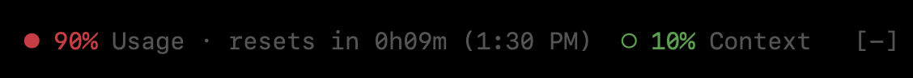
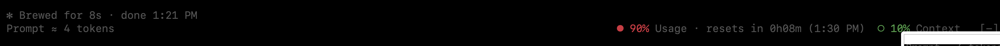

# usage-dots

A Claude Code mod that shows your plan usage and context-window fill as small
pie circles (○ ◔ ◑ ◕ ●) at the right, above the prompt. Green below 65%, yellow
from 65%, red from 85%. Hover a gauge for details: reset time and 7-day usage,
or tokens used and the biggest context category. While you type, the left of
the band shows an estimate of the prompt's token cost (about 4 characters per
token).





## Install

In a terminal Claude Code session:

```
/plugin install usage-dots --marketplace DiegoHermosilloP/usage-dots
```

From a shell:

```
claude plugin install usage-dots --marketplace DiegoHermosilloP/usage-dots
```

## Known limits

- The prompt token count is an estimate (about 4 characters per token). Mods
  have no access to a real tokenizer.
- Usage gauges appear only on a Claude subscription, and only after the first
  response reports them.
- Hover details need a terminal that passes mouse events to Claude Code.

## More mods

[reply-quote](https://github.com/DiegoHermosilloP/reply-quote): select text in
the terminal and reply to it, like the desktop app's "Reply".

## License

MIT
